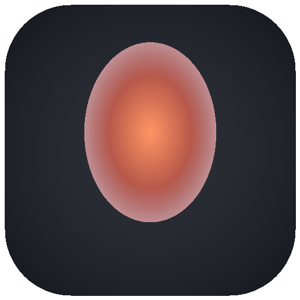
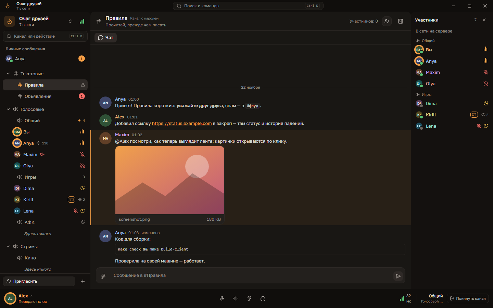
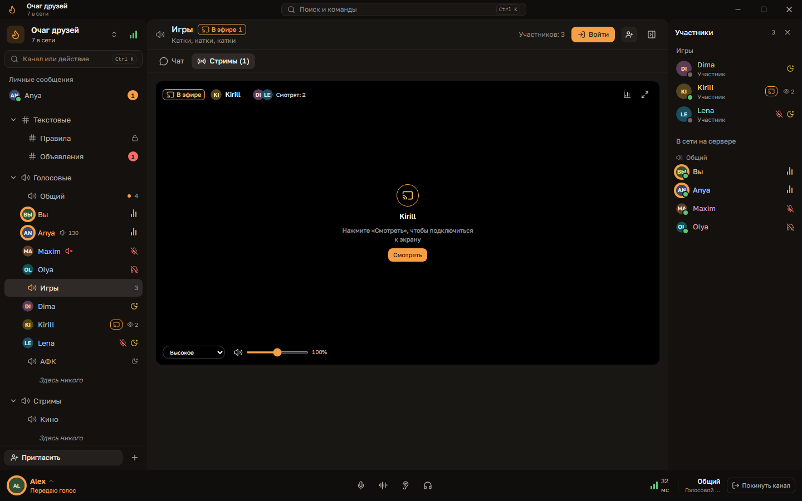
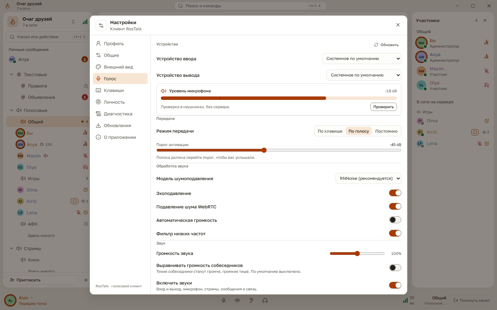
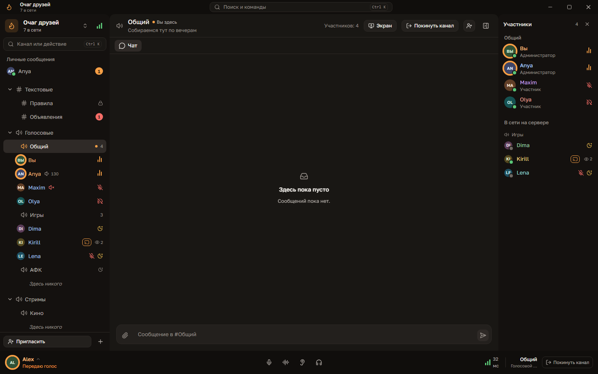
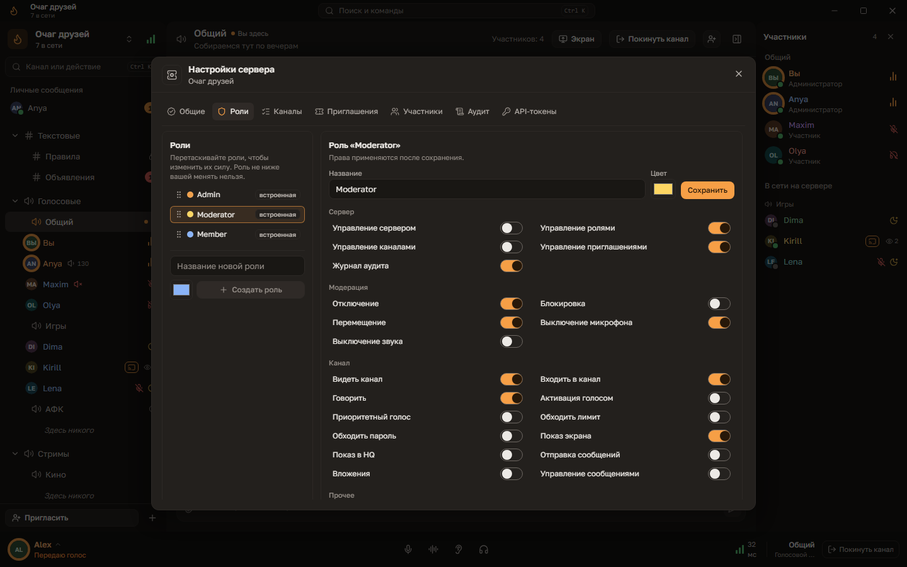
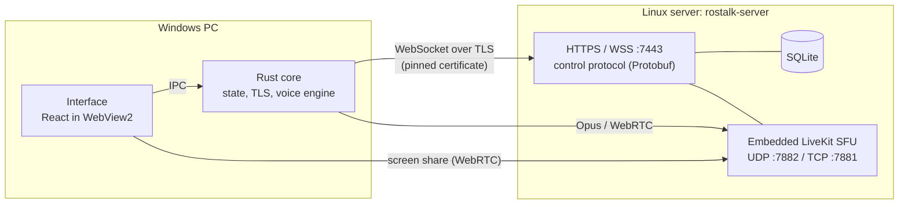

<div align="center">



# RosTalk

**Self-hosted voice chat for your group — voice, screen sharing and text chat on a server you own.**

[](https://github.com/v4dikos1/RosTalk/releases/latest)
[](LICENSE)


[Download](https://github.com/v4dikos1/RosTalk/releases/latest) ·
[Install a server](#run-your-own-server) ·
[Build from source](docs/DEVELOPMENT.md) ·
[Русский](README.ru.md)



</div>

RosTalk is a TeamSpeak-style voice chat you run yourself. The server is one
static Go binary with an embedded WebRTC SFU — no database server, no
containers required, no account system. Friends open an invite link, pick a
nickname and talk. Nothing goes through a third-party cloud.

> [!NOTE]
> RosTalk is young (0.x). The desktop client is Windows-only for now and the
> interface is in Russian and English. Expect rough edges and please
> [report them](https://github.com/v4dikos1/RosTalk/issues).

## Features

- **Low-latency voice.** Opus at 48 kHz over WebRTC (UDP), the WebRTC audio
  processing chain with echo cancellation, and a choice of noise
  suppression — WebRTC, RNNoise or DeepFilterNet.
- **Push-to-talk that works in games.** Global PTT on mouse buttons X1/X2 or
  any key, read through Raw Input — no hooks, nothing injected (see
  [anti-cheat safety](#anti-cheat-safety)). Voice activation and always-on
  modes too.
- **Screen sharing with sound.** Share a screen or a window at up to 1080p60,
  with the computer's audio; viewers pick the quality.
- **Text chat.** Channels and direct messages with images, video and file
  attachments, mentions, editing and history export.
- **Roles and moderation.** Roles with a permission matrix, per-channel
  overrides, password-protected and temporary channels, user limits, kick,
  ban, move and server mute, and an audit log.
- **No accounts, no passwords.** Each device has an Ed25519 key in the Windows
  Credential Manager. Invite links carry the server's TLS fingerprint, so a
  server without a domain is still verified — no warnings, no CA to install.
  With a domain, a Let's Encrypt certificate is obtained automatically.
- **Easy to host.** One command on a VPS, a Windows wizard that installs over
  SSH, or Docker. Runs on a 1 vCPU / 1 GB machine: the server only forwards
  packets and never transcodes.
- **Light client.** Voice runs in a native Rust core; the window is an
  ordinary WebView that can be closed to the tray (economy mode) while voice
  keeps working.
- **Signed releases and updates.** Every release is signed. The client
  installs updates from the GitHub release (**Settings → Updates**) only after
  checking the signature.

<table>
  <tr>
    <td></td>
    <td></td>
  </tr>
  <tr>
    <td></td>
    <td></td>
  </tr>
</table>

## Join a server

You need the Windows client and an invite link from the server owner.

1. Download `RosTalk-Setup-<version>.exe` from the
   [latest release](https://github.com/v4dikos1/RosTalk/releases/latest) and
   run it. It installs for the current user, without admin rights. Prefer no
   installer? Take `RosTalk-<version>-portable.zip`.
2. Open the invite link (`rostalk://join?...`) or paste it into
   **Connect to a server**.
3. Choose a nickname. That's it.

> [!IMPORTANT]
> The Windows binaries are not code-signed yet, so SmartScreen shows
> *"Windows protected your PC"*. Click **More info → Run anyway**, or verify the
> file first (see [Verifying a download](#verifying-a-download)).

## Run your own server

The server runs on Linux (x86_64 or arm64): a VPS or a machine at home. Open
these ports in the firewall and in your provider's panel:

| Port | Used for |
|---|---|
| TCP 7443 | HTTPS/WebSocket: control protocol, signalling, files |
| UDP 7882 | voice and screen sharing |
| TCP 7881 | media fallback when UDP is blocked |

**On the server, one command** (Ubuntu 22.04+, Debian 12+, Fedora 38+,
RHEL/Alma/Rocky 8+):

```sh
curl -fsSL https://github.com/v4dikos1/RosTalk/releases/latest/download/install.sh | sudo sh
```

The script verifies the release signature, installs `rostalk-server` as a
systemd service and prints the administrator invite link. Whoever opens it
first becomes the admin. Add `--domain voice.example.com` to get a Let's
Encrypt certificate. Running it again later updates the server and keeps the
data.

**From Windows, without touching a terminal:** download
`RosTalk-Server-Setup-<version>.zip`, unpack it and run
`rostalk-server-setup.exe`. It connects to your VPS over SSH, checks it,
installs the server and gives you the invite link.

**With Docker:**

```sh
git clone https://github.com/v4dikos1/RosTalk && cd RosTalk
cp deploy/docker/.env.example deploy/docker/.env   # set ROSTALK_PUBLIC_HOST
docker compose -f deploy/docker/compose.yaml up -d --build
docker compose -f deploy/docker/compose.yaml logs server   # the invite link
```

Day-to-day administration happens in the client (**Server settings**). On the
server, `rostalk-server doctor` checks ports and connectivity, `invite`
prints a new link, and `backup`/`restore` move a server between machines. The
full guide, including home networks and router port forwarding, is in
[`docs/INSTALL.md`](docs/INSTALL.md) (in Russian).

## Anti-cheat safety

People run RosTalk next to games protected by kernel-level anti-cheats —
Vanguard, Easy Anti-Cheat, BattlEye, FACEIT. The client is built to look like
what it is: an ordinary user-mode application that only works with its own
process, windows, audio devices and network connections.

- No drivers, no services, no admin rights; installs per user.
- Never opens, reads or writes other processes; no DLL injection; no overlay
  inside games.
- No input hooks and no synthetic input. Push-to-talk reads Raw Input — the
  same API games use — passively, without blocking anything.
- No packers, obfuscation or anti-debugging.

These rules are enforced, not just promised: `make check` fails if the source
or the dependency graph uses a forbidden API or crate, and the imports of every
release binary are checked against a deny list. Details and the full allow
list: [`docs/anticheat.md`](docs/anticheat.md). Anti-cheat vendors do not
publish their policies, so this lowers the risk rather than guaranteeing
compatibility; if an anti-cheat ever complains about RosTalk, please open an
issue.

## Verifying a download

Each release publishes `SHA256SUMS` with the hash of every file, signed with
the project's Ed25519 key (`SHA256SUMS.sig`; the public key is
[`deploy/release.pub`](deploy/release.pub)).

```powershell
# Windows: compare with the line for the file in SHA256SUMS
Get-FileHash .\RosTalk-Setup-0.3.0.exe -Algorithm SHA256
```

```sh
# Linux (OpenSSL 3): check the signature, then the hashes
openssl pkeyutl -verify -pubin -inkey release.pub -rawin -in SHA256SUMS -sigfile SHA256SUMS.sig
sha256sum --check --ignore-missing SHA256SUMS
```

`install.sh` and the Windows server wizard do both checks themselves, and the
client's updater accepts only installers signed with the key built into it.
Authenticode signing of the Windows binaries is planned.

## How it works



- **Server:** Go, a single static binary for linux/amd64 and arm64, SQLite in
  WAL mode, LiveKit embedded as a library. Forwards media, never decodes it.
- **Protocol:** Protobuf over one TLS WebSocket; the contract in
  [`proto/rostalk/v1`](proto/rostalk/v1) generates Go, Rust and TypeScript.
- **Client:** Tauri 2. The Rust core owns the connection, state and the voice
  engine (LiveKit Rust SDK, native libwebrtc, WASAPI through `cpal`); the
  React interface only renders snapshots and never talks to the network
  itself.
- **Identity:** an Ed25519 key per device, challenge-response login; TLS
  without a domain uses a private CA whose leaf fingerprint travels in the
  invite link.

The design and every decision behind it are documented (in Russian) in
[`docs/TECHNICAL_DESIGN.md`](docs/TECHNICAL_DESIGN.md) and
[`docs/adr/`](docs/adr/).

## Building from source

You need Go, Rust (MSVC toolchain on Windows), Node.js 24, buf and Docker
Desktop for the server on Windows.

```sh
make setup        # dependencies and pinned code generators
make check        # every linter and test, plus the anti-cheat checks
make build-client # release build of the Windows client
```

The full guide — dev server in Docker, LAN IP setup, integration tests — is in
[`docs/DEVELOPMENT.md`](docs/DEVELOPMENT.md); releases are described in
[`docs/RELEASE.md`](docs/RELEASE.md).

## Roadmap

- Authenticode-signed Windows builds.
- A browser client, then mobile clients.
- Webcam video and an optional in-game overlay (only if it can be done
  without injection; see [`docs/anticheat.md`](docs/anticheat.md)).

## Contributing

Bug reports, ideas and pull requests are welcome. Please read
[`CONTRIBUTING.md`](CONTRIBUTING.md) first — especially the anti-cheat rules.
Security issues: see [`SECURITY.md`](SECURITY.md).

## License

RosTalk is released under the [MIT License](LICENSE). Third-party components
and their licenses are listed in [`THIRD_PARTY_NOTICES.md`](THIRD_PARTY_NOTICES.md).

RosTalk was called *Hearth* before version 0.3.0; old installations migrate
automatically (see [`docs/INSTALL.md`](docs/INSTALL.md)).
