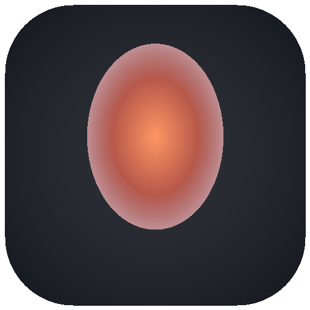
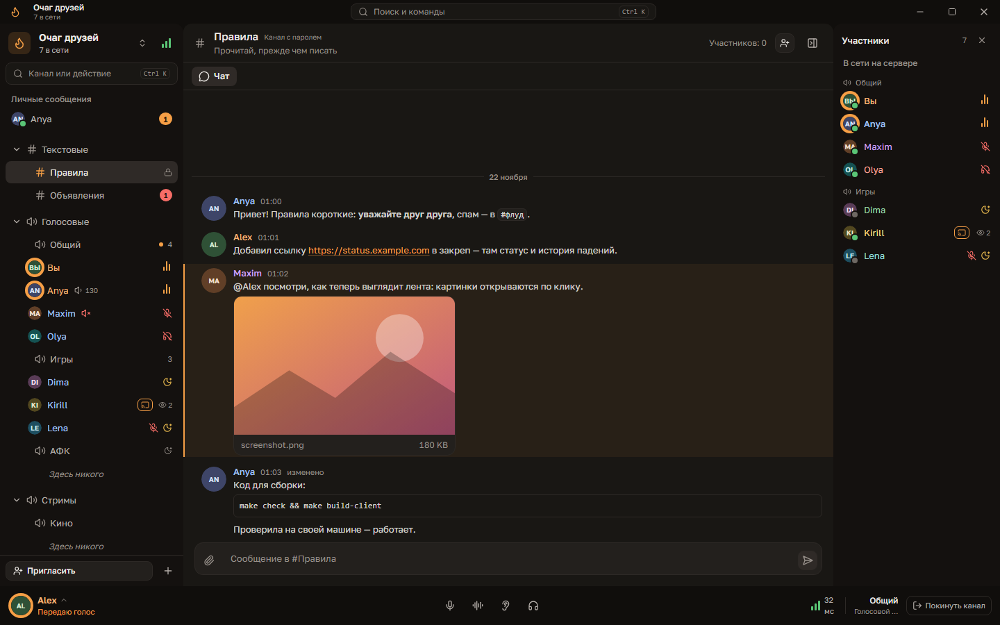
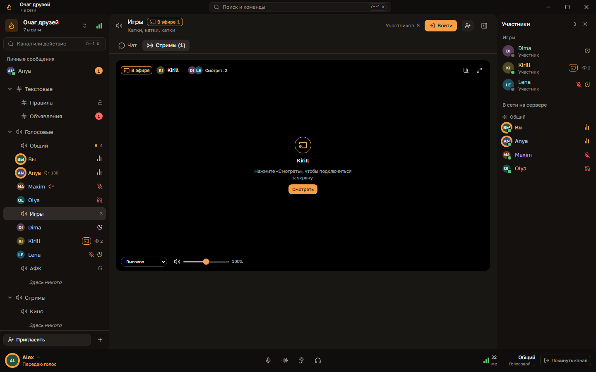
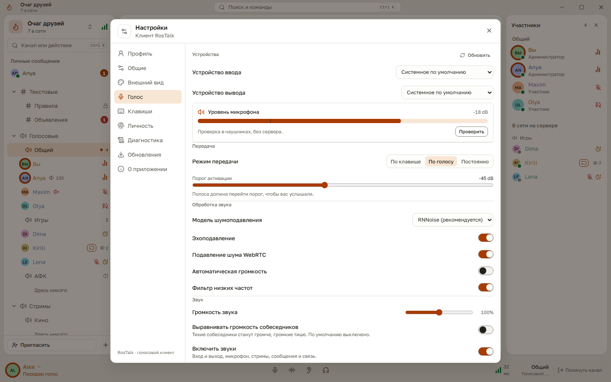
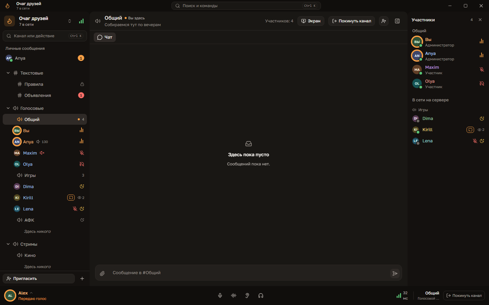
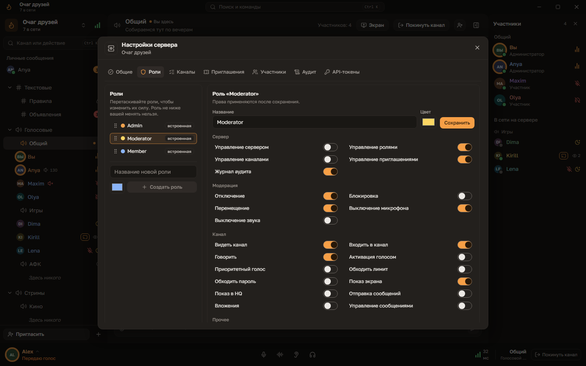
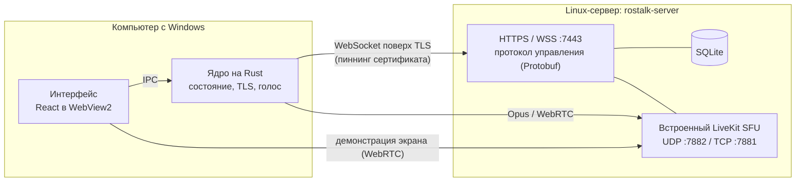

<div align="center">



# RosTalk

**Голосовой чат на своём сервере: голос, демонстрация экрана и текстовый чат без чужих облаков.**

[](https://github.com/v4dikos1/RosTalk/releases/latest)
[](LICENSE)


[Скачать](https://github.com/v4dikos1/RosTalk/releases/latest) ·
[Свой сервер](#свой-сервер) ·
[Сборка из исходников](docs/DEVELOPMENT.md) ·
[English](README.md)



</div>

RosTalk — голосовой чат в духе TeamSpeak, который вы запускаете сами. Сервер —
один статический бинарник на Go со встроенным WebRTC-SFU: без отдельной базы
данных, без обязательных контейнеров и без регистрации. Друзья открывают
ссылку-приглашение, вводят ник и говорят. Через сторонние облака ничего не
проходит.

> [!NOTE]
> Проект молодой (0.x). Клиент пока только для Windows, интерфейс на русском и
> английском. Шероховатости будут — пожалуйста,
> [сообщайте о них](https://github.com/v4dikos1/RosTalk/issues).

## Возможности

- **Голос с низкой задержкой.** Opus 48 кГц поверх WebRTC (UDP), обработка
  звука WebRTC с эхоподавлением и шумоподавление на выбор — WebRTC, RNNoise
  или DeepFilterNet.
- **Push-to-talk, который работает в играх.** Глобальная кнопка на X1/X2 мыши
  или любой клавише через Raw Input — без хуков и инъекций (см.
  [античиты](#античиты)). Есть активация голосом и постоянная передача.
- **Демонстрация экрана со звуком.** Экран или окно до 1080p60 вместе со
  звуком компьютера; зрители сами выбирают качество.
- **Текстовый чат.** Каналы и личные сообщения, картинки, видео и файлы,
  упоминания, редактирование, экспорт истории.
- **Роли и модерация.** Роли с матрицей прав, переопределения на канал,
  каналы с паролем и временные каналы, лимиты участников, kick, ban,
  перемещение и server mute, журнал аудита.
- **Без аккаунтов и паролей.** У каждого устройства свой ключ Ed25519 в
  диспетчере учётных данных Windows. В ссылке-приглашении — отпечаток
  TLS-сертификата сервера, поэтому сервер без домена тоже проверяется: без
  предупреждений и без установки сертификатов. С доменом сертификат Let's
  Encrypt выпускается сам.
- **Просто поднять.** Одна команда на VPS, мастер для Windows, который ставит
  сервер по SSH, или Docker. Хватает 1 vCPU и 1 ГБ: сервер только пересылает
  пакеты и ничего не перекодирует.
- **Лёгкий клиент.** Голос работает в нативном ядре на Rust; окно —
  обычный WebView, его можно свернуть в трей (экономный режим), голос
  продолжит работать.
- **Подписанные релизы и обновления.** Каждый релиз подписан. Клиент ставит
  обновление из релиза на GitHub («Настройки → Обновления») только после
  проверки подписи.

<table>
  <tr>
    <td></td>
    <td></td>
  </tr>
  <tr>
    <td></td>
    <td></td>
  </tr>
</table>

## Подключиться к серверу

Нужны клиент для Windows и ссылка-приглашение от владельца сервера.

1. Скачайте `RosTalk-Setup-<версия>.exe` из
   [последнего релиза](https://github.com/v4dikos1/RosTalk/releases/latest) и
   запустите. Установка идёт в профиль пользователя, без прав администратора.
   Без установщика — `RosTalk-<версия>-portable.zip`.
2. Откройте ссылку-приглашение (`rostalk://join?...`) или вставьте её в окне
   «Подключиться к серверу».
3. Введите ник. Готово.

> [!IMPORTANT]
> Сборки для Windows пока без цифровой подписи, поэтому SmartScreen покажет
> «Windows защитила ваш компьютер». Нажмите «Подробнее → Выполнить в любом
> случае» или сначала проверьте файл (см. [Проверка загрузки](#проверка-загрузки)).

## Свой сервер

Сервер работает на Linux (x86_64 или arm64): VPS или домашняя машина.
Откройте порты на файрволе и в панели провайдера:

| Порт | Зачем |
|---|---|
| TCP 7443 | HTTPS/WebSocket: управление, сигналинг, файлы |
| UDP 7882 | голос и демонстрация экрана |
| TCP 7881 | запасной путь медиа, если UDP закрыт |

**Прямо на сервере — одна команда** (Ubuntu 22.04+, Debian 12+, Fedora 38+,
RHEL/Alma/Rocky 8+):

```sh
curl -fsSL https://github.com/v4dikos1/RosTalk/releases/latest/download/install.sh | sudo sh
```

Скрипт проверяет подпись релиза, ставит `rostalk-server` как службу systemd и
печатает ссылку администратора: кто откроет её первым, тот и администратор.
С `--domain voice.example.com` сертификат Let's Encrypt выпустится сам.
Повторный запуск позже обновляет сервер и не трогает данные.

**С Windows, без терминала:** скачайте `RosTalk-Server-Setup-<версия>.zip`,
распакуйте и запустите `rostalk-server-setup.exe`. Программа подключится к
VPS по SSH, проверит его, установит сервер и выдаст ссылку-приглашение.

**В Docker:**

```sh
git clone https://github.com/v4dikos1/RosTalk && cd RosTalk
cp deploy/docker/.env.example deploy/docker/.env   # укажите ROSTALK_PUBLIC_HOST
docker compose -f deploy/docker/compose.yaml up -d --build
docker compose -f deploy/docker/compose.yaml logs server   # ссылка-приглашение
```

Повседневное администрирование — в клиенте («Настройки сервера»). На самом
сервере `rostalk-server doctor` проверяет порты и связность, `invite`
печатает новую ссылку, `backup`/`restore` переносят сервер на другую машину.
Полное руководство, включая домашнюю сеть и проброс портов, —
[`docs/INSTALL.md`](docs/INSTALL.md).

## Античиты

RosTalk запускают рядом с играми под kernel-level античитами — Vanguard, Easy
Anti-Cheat, BattlEye, FACEIT. Клиент устроен так, чтобы выглядеть тем, чем он
является: обычным user-mode-приложением, которое работает только со своим
процессом, своими окнами, своими аудиоустройствами и сетью.

- Ни драйверов, ни служб, ни прав администратора; установка в профиль
  пользователя.
- Не открывает, не читает и не пишет чужие процессы; не внедряет DLL; нет
  оверлея внутри игр.
- Ни хуков ввода, ни синтетического ввода. Push-to-talk пассивно читает Raw
  Input — тот же API, которым пользуются сами игры, — ничего не блокируя.
- Ни упаковщиков, ни обфускации, ни антиотладки.

Это проверяется автоматически, а не только обещается: `make check` падает,
если исходники или граф зависимостей используют запрещённый API или крейт, а
импорты каждого release-бинарника сверяются со списком запрещённых.
Подробности и полный белый список — [`docs/anticheat.md`](docs/anticheat.md).
Политики античитов закрыты, поэтому это снижает риск, но не гарантирует
совместимость; если античит когда-нибудь пожалуется на RosTalk, заведите issue.

## Проверка загрузки

В каждом релизе есть `SHA256SUMS` с хешами всех файлов, подписанный ключом
Ed25519 проекта (`SHA256SUMS.sig`; публичный ключ —
[`deploy/release.pub`](deploy/release.pub)).

```powershell
# Windows: сравните со строкой этого файла в SHA256SUMS
Get-FileHash .\RosTalk-Setup-0.3.0.exe -Algorithm SHA256
```

```sh
# Linux (OpenSSL 3): сначала подпись, потом хеши
openssl pkeyutl -verify -pubin -inkey release.pub -rawin -in SHA256SUMS -sigfile SHA256SUMS.sig
sha256sum --check --ignore-missing SHA256SUMS
```

`install.sh` и мастер установки сервера делают обе проверки сами, а апдейтер
клиента принимает только установщики, подписанные встроенным в него ключом.
Подпись Authenticode для Windows-сборок запланирована.

## Как это устроено



- **Сервер:** Go, один статический бинарник под linux/amd64 и arm64, SQLite в
  режиме WAL, LiveKit встроен как библиотека. Пересылает медиа, не декодирует.
- **Протокол:** Protobuf поверх одного TLS WebSocket; контракт в
  [`proto/rostalk/v1`](proto/rostalk/v1) генерирует Go, Rust и TypeScript.
- **Клиент:** Tauri 2. Ядро на Rust держит соединение, состояние и голосовой
  движок (LiveKit Rust SDK, нативный libwebrtc, WASAPI через `cpal`);
  интерфейс на React только отображает снимки и сам в сеть не ходит.
- **Личность:** ключ Ed25519 на устройство, вход по challenge-response; TLS
  без домена — собственный CA, отпечаток листа передаётся в ссылке.

Устройство и все решения описаны в
[`docs/TECHNICAL_DESIGN.md`](docs/TECHNICAL_DESIGN.md) и [`docs/adr/`](docs/adr/).

## Сборка из исходников

Нужны Go, Rust (на Windows — MSVC-тулчейн), Node.js 24, buf и Docker Desktop
для сервера под Windows.

```sh
make setup        # зависимости и запиненные генераторы кода
make check        # все линтеры и тесты, включая античит-проверки
make build-client # release-сборка клиента для Windows
```

Подробно — dev-сервер в Docker, LAN IP, интеграционные тесты — в
[`docs/DEVELOPMENT.md`](docs/DEVELOPMENT.md); выпуск релиза —
[`docs/RELEASE.md`](docs/RELEASE.md).

## Планы

- Сборки для Windows с подписью Authenticode.
- Клиент в браузере, затем мобильные клиенты.
- Видео с веб-камеры и, возможно, оверлей в играх — только если получится без
  инъекций (см. [`docs/anticheat.md`](docs/anticheat.md)).

## Участие

Баг-репорты, идеи и pull request'ы приветствуются. Сначала прочитайте
[`CONTRIBUTING.md`](CONTRIBUTING.md) — особенно правила про античиты.
Уязвимости — по [`SECURITY.md`](SECURITY.md).

## Лицензия

RosTalk распространяется по [лицензии MIT](LICENSE). Сторонние компоненты и
их лицензии — в [`THIRD_PARTY_NOTICES.md`](THIRD_PARTY_NOTICES.md).

До версии 0.3.0 проект назывался *Hearth*; старые установки переносятся
автоматически (см. [`docs/INSTALL.md`](docs/INSTALL.md)).
