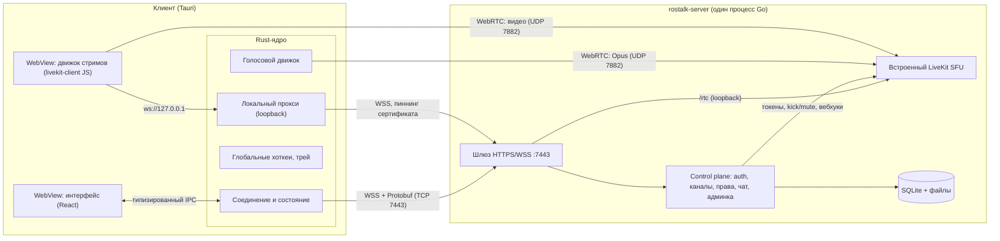
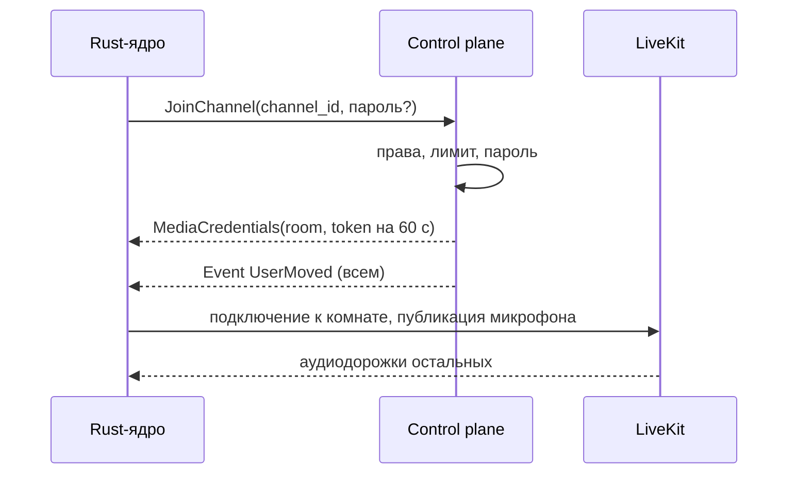

# RosTalk — техническое решение

Self-hosted голосовой чат для небольшой компании друзей: аналог TeamSpeak с демонстрацией экрана, установкой сервера в одну команду и современным интерфейсом.

> До версии 0.3.0 проект назывался Hearth (ADR 0033). Решения, принятые после
> этого документа, — в `docs/adr/`; при расхождении приоритет у ADR.

---

## 1. Цели и допущения

### Что должно получиться

| Требование | Как закрывается |
|---|---|
| Демонстрация экрана в self-hosted | SFU на сервере, захват и просмотр в клиенте (раздел 5.3) |
| Простая установка сервера | Один бинарник без зависимостей, нулевая конфигурация, invite-ссылка в консоли (раздел 7) |
| Современный дизайн и UX | UI на веб-технологиях внутри Tauri (раздел 5.4) |
| Быстродействие клиента | Голос в нативном Rust-ядре, WebView только для интерфейса, «экономный режим» без WebView (раздел 5.5) |
| Лёгкий сервер | Один процесс Go, SQLite, сервер только пересылает пакеты и ничего не кодирует |
| Администрирование | Роли, права, переопределения на канал, инвайты, kick/ban/move/mute, журнал аудита (раздел 4.4) |
| Низкая задержка и качество звука | Opus 48 кГц поверх WebRTC (UDP), обработка и джиттер-буфер из libwebrtc (раздел 5.2) |

### Платформы и допущения

- Масштаб: один сервер, до ~50 человек онлайн, до ~15 в одном канале.
- Клиент MVP — Windows 10/11. Сборки под macOS и Linux возможны тем же кодом, но в MVP не проверяются.
- После MVP — клиент в браузере и на мобильных (раздел 12). Они вторичны: при любом конфликте решение принимается в пользу клиента для Windows.
- Сервер — только Linux (amd64 и arm64): VPS или домашняя машина с пробросом портов.

### Не-цели

- Федерация, несколько виртуальных серверов в одном процессе, горизонтальное масштабирование.
- Сквозное шифрование (E2EE) в первой версии: сервер свой, трафик шифруется до сервера.
- Видео с веб-камеры, боты с музыкой, оверлей в играх — в бэклог.

---

## 2. Стек

| Слой | Выбор | Почему |
|---|---|---|
| Сервер | Go, один статический бинарник | Статическая сборка под Linux amd64 и arm64, низкое потребление памяти |
| Медиа-сервер (SFU) | LiveKit Server, встроенный в тот же бинарник | Готовые SFU, simulcast, оценка канала, TURN, один UDP-порт. Лицензия Apache-2.0 |
| Хранилище | SQLite (WAL), `modernc.org/sqlite` без CGO, `sqlc` + встроенные миграции | Один файл, бэкап копированием, не нужен отдельный сервис |
| Протокол управления | Protobuf поверх одного WebSocket (TLS) | Один контракт генерируется в Go, Rust и TypeScript |
| Оболочка клиента | Tauri 2 | Установщик ~10–15 МБ, системный WebView вместо встроенного Chromium |
| Ядро клиента | Rust: `livekit` SDK (нативный libwebrtc), `cpal`, `tokio` | Голос работает независимо от окна интерфейса |
| Интерфейс | React + TypeScript + Vite + Tailwind + shadcn/ui, Zustand | Быстро получить современный UI; самая распространённая связка с готовыми компонентами |
| Стримы экрана | `livekit-client` (JS) в WebView; запасной путь — нативный захват в Rust | Аппаратное кодирование и декодирование средствами WebView |
| Идентичность | Ключ Ed25519 на устройстве, без регистрации и паролей | Как в TeamSpeak: зашёл по ссылке, ввёл ник, говоришь |

Проверенные на 2026-11 версии: `livekit` 0.12.0, `libwebrtc` 0.4.2, `tauri` 2.12.7, `cpal` 0.18.2; `livekit-server` 1.13.11 (требует Go 1.26, собрано на Go 1.27.4), `livekit-api` 0.11.0, Rust 1.97.1. Сборка libwebrtc под Linux требует clang 21+. Результаты проверок — в `docs/adr/0001`–`0003`.

---

## 3. Архитектура



Две плоскости:

- **Control plane** — всё, что есть «состояние сервера»: кто онлайн, дерево каналов, права, чат, модерация. Источник истины — наш Go-код и SQLite.
- **Media plane** — звук и видео. Канал = комната LiveKit. Control plane решает, кого пустить в комнату и с какими правами, и выдаёт короткоживущий токен.

Клиент ничего не знает о LiveKit, кроме «вот адрес и токен, подключайся». Вся работа с LiveKit на сервере спрятана за интерфейсом `MediaBackend`: если встроенный LiveKit окажется слишком тяжёлым, его можно заменить собственным SFU на Pion, не трогая остальное.

---

## 4. Сервер

### 4.1 Процесс и порты

| Порт | Назначение |
|---|---|
| TCP 7443 | HTTPS/WSS: протокол управления, сигналинг LiveKit (`/rtc`), файлы, HTTP API |
| UDP 7882 | Весь медиа-трафик (LiveKit в режиме одного UDP-порта, `rtc.udp_port`) |
| TCP 7881 | Запасной путь для медиа, если у клиента закрыт UDP (ICE-TCP) |

LiveKit слушает сигналинг только на loopback; наружу его проксирует шлюз. API-ключ и секрет LiveKit генерируются при первом запуске и не покидают процесс.

Внешний IP определяется автоматически (`rtc.use_external_ip`), для домашнего хостинга — попытка проброса через UPnP/NAT-PMP.

В dev-окружении на Windows (сервер в Docker Desktop) LiveKit анонсирует **LAN IP хоста**, а не `127.0.0.1`, и `enable_loopback_candidate` выключается. Проверено в ADR 0001: клиент на хосте не может отправить медиа на loopback с LAN-адреса, а вариант с LAN IP и выключенным loopback работает по UDP. Ссылка-приглашение в этом режиме содержит тот же хост (`rostalk://join?host=192.168.x.x:7443&...`).

### 4.2 Идентичность и вход

1. Клиент при первом запуске генерирует ключ Ed25519 и хранит его в системном хранилище ключей.
2. Подключение: `Hello{версия, public_key, ник, invite?}` → сервер шлёт `Challenge{nonce}` → клиент подписывает `nonce + идентификатор сервера` → `Welcome{снимок состояния}`.
3. Пользователь на сервере = публичный ключ. Ник свободный, уникальность в пределах онлайна.
4. Идентификатор сервера — отпечаток его долгоживущего ключа. Без домена он совпадает с `fp` из ссылки-приглашения; с доменом клиент получает его при первом входе по доверенному TLS и запоминает. Клиент подписывает только сохранённый идентификатор, поэтому чужой сервер не сможет переслать подпись дальше, а вход не зависит от того, какой TLS-сертификат видит клиент (важно для браузера).
5. Режимы сервера: по инвайтам (по умолчанию), по паролю, открытый.
6. Экспорт и импорт ключа — файл с паролем, чтобы перенести личность на другой ПК.

Первый запуск сервера печатает одноразовую админ-ссылку: кто по ней зашёл, тот получает роль Admin (аналог privilege key в TeamSpeak).

### 4.3 TLS без домена

- **Без домена (по умолчанию):** сервер генерирует долгоживущий самоподписанный сертификат. Отпечаток ключа вшит в invite-ссылку, клиент сверяет его при каждом подключении (как SSH и Mumble).
- **С доменом:** флаг `--domain`, сертификат Let's Encrypt выпускается и обновляется автоматически (`certmagic`).

Формат ссылки: `rostalk://join?host=203.0.113.5:7443&fp=<sha256>&invite=<token>`.

WebView самоподписанный сертификат не примет, поэтому все его запросы к серверу (сигналинг стримов, картинки, файлы) идут через локальный прокси в Rust-ядре: `127.0.0.1:<случайный порт>` с одноразовым токеном сессии.

### 4.4 Права и администрирование

Модель «роли + переопределения на канал» — проще для понимания, чем числовые power-значения TeamSpeak.

- Роль: название, цвет, позиция, набор прав. Стандартные: Admin, Moderator, Member, Guest.
- Канал: для каждой роли можно задать allow/deny отдельных прав.
- Расчёт: объединение прав ролей → deny канала → allow канала. Право `manage_server` обходит всё.
- Иерархия: действовать можно только на тех, чья старшая роль ниже твоей.

| Группа | Права |
|---|---|
| Сервер | `manage_server`, `manage_roles`, `manage_channels`, `manage_invites`, `view_audit_log` |
| Модерация | `kick`, `ban`, `move_members`, `mute_members`, `deafen_members` |
| Канал: голос | `view_channel`, `join`, `speak`, `use_voice_activation`, `priority_speaker`, `bypass_user_limit`, `bypass_password` |
| Канал: стримы | `stream`, `stream_hq` |
| Канал: чат | `send_messages`, `attach_files`, `manage_messages` |
| Прочее | `create_temp_channel`, `change_nickname` |

Как права применяются к медиа (сервер, а не клиент):

| Действие | Механизм LiveKit |
|---|---|
| Нет права `speak` | Токен без `canPublish` |
| Право `stream` | Отдельный токен с `canPublishSources: [screen_share, screen_share_audio]` |
| Серверный mute | `UpdateParticipant` с `canPublish=false` |
| Kick, ban, move | `RemoveParticipant` + событие control plane |
| Лимит качества стрима | Пресет в токене; ограничение мягкое — его соблюдает клиент |

Три способа администрировать: интерфейс в клиенте (основной), CLI `rostalk-server admin …`, HTTP API с токенами для ботов и скриптов.

### 4.5 Модель данных (SQLite)

| Таблица | Содержимое |
|---|---|
| `settings` | Имя сервера, режим входа, лимиты, ключи LiveKit |
| `users` | `id`, `public_key`, ник, первое и последнее появление |
| `roles`, `user_roles` | Роли и назначения |
| `channels` | Дерево (`parent_id`, `position`), тема, пароль, лимит, голосовой профиль, временный ли |
| `channel_overrides` | allow/deny на пару канал–роль |
| `invites` | Хеш токена, роль, срок, число использований |
| `bans` | По ключу и по IP, причина, срок |
| `messages`, `attachments` | Чат каналов и личные сообщения |
| `audit_log` | Кто, что, над кем, когда |
| `api_tokens` | Токены HTTP API |

Онлайн-состояние (кто в каком канале, mute, стримит ли) живёт в памяти и в базу не пишется.

### 4.6 Протокол управления

Один WebSocket, бинарные Protobuf-кадры, запрос–ответ по `request_id` плюс серверные события.

```proto
message ClientFrame {
  uint64 request_id = 1;
  oneof payload {
    Hello hello = 10;
    Authenticate authenticate = 11;
    JoinChannel join_channel = 20;
    SetVoiceState set_voice_state = 21;   // mute, deafen
    RequestStreamToken request_stream_token = 30;
    SendMessage send_message = 40;
    AdminAction admin_action = 50;        // kick, ban, move, роли, каналы
    // ...
  }
}

message ServerFrame {
  uint64 reply_to = 1;                    // 0 для событий
  oneof payload {
    Error error = 2;
    Challenge challenge = 10;
    Welcome welcome = 11;                 // полный снимок состояния
    MediaCredentials media_credentials = 20;
    Event event = 100;                    // UserJoined, UserMoved, ChannelUpdated, ...
  }
}
```

- Состояние маленькое, поэтому после переподключения сервер шлёт полный снимок, а не дельты.
- Индикатор «говорит» через control plane не передаётся: клиент считает уровень звука сам.
- Версия протокола проверяется в `Hello`; несовместимый клиент получает понятную ошибку со ссылкой на обновление.

### 4.7 Вход в канал



Идентификаторы участников LiveKit: `<user_id>:voice` (Rust-ядро) и `<user_id>:stream` (WebView, создаётся только когда пользователь стримит или смотрит стрим). Список людей в канале интерфейс берёт из control plane, а не из LiveKit.

Тип дорожки клиенты определяют по её источнику (`microphone`, `screen_share`, `screen_share_audio`), а не по суффиксу идентификатора. Так браузерный клиент сможет публиковать и голос, и стрим одним участником.

---

## 5. Клиент

### 5.1 Устройство процесса

- **Rust-ядро** владеет соединением с сервером, состоянием, голосом, хоткеями, треем и ключом. Работает без окна.
- **WebView** — интерфейс и движок стримов. Общается с ядром через типизированный IPC (`tauri-specta` генерирует TypeScript-типы из Rust).
- Интерфейс не хранит собственной истины: ядро отдаёт снимок и дельты состояния, UI их рисует и шлёт команды.
- UI зависит только от TypeScript-интерфейса `CoreApi`. Вызовы Tauri живут в одном адаптере; после MVP появится второй — для браузера.

### 5.2 Голосовой движок

```text
микрофон (cpal, 48 кГц, кадры 10 мс)
  → ресемплинг при необходимости
  → APM из libwebrtc: фильтр ВЧ, эхоподавление (AEC3), шумоподавление, АРУ
  → [опция] RNNoise
  → гейт: PTT / активация голосом / постоянная передача
  → NativeAudioSource → дорожка LiveKit (Opus, FEC/RED, DTX)

входящие дорожки (NetEQ внутри libwebrtc: джиттер-буфер, маскировка потерь)
  → громкость и mute на пользователя
  → микшер → опорный сигнал для AEC
  → устройство вывода (cpal)
```

- Аудио-колбэки без блокировок и аллокаций: обмен через кольцевые буферы.
- Push-to-talk: Raw Input (`RegisterRawInputDevices` + `RIDEV_INPUTSINK`) на скрытом окне, работает в фоне и не «съедает» клавишу; низкоуровневые `WH_*`-хуки не используются (ADR 0012, совместимость с Vanguard). Плагин `global-shortcut` годится только для обычных хоткеев.
- Настройки: выбор устройств с горячим переподключением, проверка микрофона (петля), порог активации с индикатором уровня, громкость на пользователя 0–200 %.

Голосовые профили канала (задаёт админ):

| Профиль | Opus | Обработка |
|---|---|---|
| Голос (по умолчанию) | моно, ~48 кбит/с | вся |
| Голос HQ | моно, ~96 кбит/с | вся |
| Музыка | стерео, ~192 кбит/с | отключена |

Целевая задержка «рот–ухо» в хорошей сети — 60–120 мс: захват 10 + кадр 10–20 + сеть + джиттер-буфер 20–60 + вывод 10. Это цель, а не измерение; проверяется на этапе 7.1.

### 5.3 Движок стримов

Основной путь — WebView2 на Windows (подтверждён в Chromium против настоящего LiveKit, ADR 0003; специфика WebView2 проверяется на этапе 5.1):

- Захват: `getDisplayMedia` со штатным выбором экрана или окна.
- Публикация: `livekit-client`, H.264 с аппаратным кодированием или VP9, simulcast в два слоя.
- Просмотр: подписка только по клику «Смотреть», аппаратное декодирование, `<video>`.
- Пресеты (ориентиры по битрейту): 720p30 ~2,5 Мбит/с, 1080p30 ~4, 1080p60 ~6–8, «исходное» ~10–12.
- Режимы: «игра» (приоритет плавности) и «текст» (приоритет чёткости).

Запасной/опциональный путь — нативный WGC (ADR 0028): Windows.Graphics.Capture
через системный пикер, `IsCursorCaptureEnabled(false)`, кадры I420 в
`livekit`/libwebrtc с **программным VP8 simulcast** (720p30: 180p+720p,
1080p30: 360p+720p+1080p). NVENC/аппаратный MFT — только необязательная
оптимизация, не условие работы. Просмотр остаётся в WebView2/`livekit-client`;
нативный режим выключен по умолчанию до G7 и решения о выпуске.

Звук стрима:

- Сначала — системный звук через `getDisplayMedia` (Windows). Минус: в стрим попадают голоса друзей.
- Затем — захват звука конкретного приложения через WASAPI process loopback в Rust, отдельной дорожкой. Голоса из чата в стрим не попадают.

Нагрузка на канал сервера: исходящий трафик ≈ битрейт × число зрителей. Стрим 1080p30 на четверых — около 16 Мбит/с; учитывай лимиты трафика VPS.

### 5.4 Интерфейс

- Одно окно: слева дерево каналов с людьми внутри (как в TeamSpeak), в центре чат или стримы, снизу панель «микрофон / звук / экран / настройки» и индикатор качества связи.
- Первый запуск: вставил ссылку → ввёл ник → проверил микрофон → в канале. Три шага.
- Правый клик по человеку: громкость, mute для себя, личное сообщение; модераторам — kick, ban, move, mute. Перетаскивание людей между каналами.
- Командная палитра (Ctrl+K), настраиваемые хоткеи, тёмная и светлая темы, компактный режим, русский и английский.
- Звуки событий (вход, выход, mute) с регулировкой и отключением.

### 5.5 Экономный режим

Свернул в трей — через N минут окно с WebView уничтожается, остаётся только Rust-ядро с голосом. Развернул — окно создаётся заново и получает снимок состояния. Пока идёт свой стрим или просмотр чужого, режим не включается.

---

## 6. Целевые бюджеты производительности

Это цели для проверки на этапе 7.1, а не результаты измерений.

| Сценарий | Память | CPU |
|---|---|---|
| Клиент в канале, экономный режим | < 80 МБ | < 1 % |
| Клиент в канале, окно открыто | < 250 МБ | < 2 % в простое |
| Сервер без пользователей | < 150 МБ | ~0 % |
| Сервер, 10 человек говорят | < 250 МБ | < 10 % одного ядра |

Сервер не перекодирует ни звук, ни видео, поэтому для голоса хватит VPS с 1 vCPU и 1 ГБ; для стримов важна полоса, а не процессор.

---

## 7. Установка и распространение

Сервер:

| Способ | Команда |
|---|---|
| Скрипт | `curl -fsSL https://<твой-хост>/install.sh \| sh` — бинарник, systemd-юнит, правила файрвола |
| Docker | `docker run -d --network host -v rostalk:/data ghcr.io/<ты>/rostalk-server` |
| Вручную | Скачать бинарник и запустить `rostalk-server run` |

Первый запуск без единого вопроса: ключи, база, сертификат, определение внешнего IP, каналы «Лобби» и «AFK», стандартные роли, админ-ссылка и QR в консоли. Все дальнейшие настройки — из клиента.

- Бэкап: `rostalk-server backup` — один архив с базой, файлами и ключами.
- Обновление сервера: `rostalk-server update` с проверкой подписи, либо новый Docker-образ.
- Разработка на Windows: сервер запускается в Docker Desktop с опубликованными портами, клиент подключается к `https://<LAN IP хоста>:7443`. Адрес для медиа задаётся явно (`--advertise-ip <LAN IP>` и `enable_loopback_candidate=false`), потому что клиент с Windows-хоста не может отправить медиа на `127.0.0.1`, а адрес контейнера с хоста недоступен (ADR 0001).
- Клиент: установщик для Windows через GitHub Releases, автообновление Tauri с подписью, обработчик ссылок `rostalk://`.

---

## 8. Безопасность

- Всё управление — по TLS с пиннингом или Web PKI; медиа — DTLS-SRTP.
- По умолчанию вход только по инвайтам; лимиты частоты на вход, сообщения и загрузки.
- Пароли каналов — argon2id. Токены инвайтов и API хранятся хешами.
- Загрузки: лимит размера, квота на диск, проверка типа; картинки отдаются без исполнения.
- Клиент: минимальные capabilities Tauri, строгий CSP, весь сетевой доступ WebView только через локальный прокси, предпросмотр ссылок выключен по умолчанию.
- Журнал аудита всех админ-действий.

---

## 9. Риски и что проверено

Проверено по исходникам (2026-11):

- `livekit-server` можно запустить из своего Go-кода: `service.InitializeServer(conf, node)` и `server.Start()` лежат в публичных пакетах.
- В Rust-крейте `libwebrtc` есть `AudioProcessingModule` (эхо, шум, АРУ, ВЧ-фильтр), аудиомикшер, `DesktopCapturer`, аппаратные кодировщики NVIDIA/VAAPI/VideoToolbox; в репозитории есть примеры `local_audio` (с `cpal`), `screensharing`, `wgpu_room`.
- В токенах LiveKit есть `canPublish`, `canSubscribe`, `canPublishSources`, `hidden`; в конфиге — `rtc.udp_port`, `rtc.tcp_port`, `use_external_ip`, встроенный TURN, вебхуки.
- Плагин Tauri `global-shortcut` различает нажатие и отпускание.

Этап 0 закрыл часть рисков; результаты — в ADR 0001–0003:

- встраивание LiveKit, сборка amd64/arm64, UDP-медиа и бюджеты — ADR 0001;
- голосовой тракт Rust, APM, Opus-параметры и задержка — ADR 0002;
- стрим через WebView-движок и loopback-прокси — ADR 0003.

Осталось проверить руками (нужны Windows с MSVC/WebView2 и железо):

| Риск | Проверка | Если не получится |
|---|---|---|
| Память и CPU встроенного LiveKit на настоящем Linux | Этап 7.1 (в Docker Desktop измерено: 12–80 МБ, 0.4–32 % ядра) | Свой SFU на Pion за интерфейсом `MediaBackend` |
| `getDisplayMedia` в WebView2, системный звук, `ws://127.0.0.1` из страницы Tauri | Ручной чек-лист этапа 5.1; движок проверен в Chromium (ADR 0003) | Нативный путь стримов из раздела 5.3 как основной |
| Аппаратное кодирование в WebView2 и в нативном пути на Windows | Этап 5.1/5.2 | Программный VP8/H.264 с пресетом не выше 1080p30 |
| WASAPI process loopback и минимальная версия Windows для него | Этап 5.2 | Оставить системный звук с предупреждением об эхе |
| Перехват PTT в играх с античитом | Этап 2.3 | Запасной вариант через `global-shortcut` |
| Сборка Rust-клиента под Windows (MSVC) | Первый CI-job `windows-latest` | Без неё этап 2.3 не закрывать |

---

## 10. Отвергнутые альтернативы

| Вариант | Почему нет |
|---|---|
| Electron | Тот же профиль потребления, что у Discord: встроенный Chromium и Node в каждом клиенте |
| Весь медиа-стек в WebView | Голос умирает вместе с окном, экономный режим невозможен, меньше контроля над обработкой звука и PTT |
| Полностью нативный UI (Qt, Slint, egui) | Самый лёгкий клиент, но современный дизайн и чат с картинками обходятся заметно дороже. Возможен позже: ядро от UI не зависит |
| Flutter + `livekit_client` | Реальная альтернатива с мобильными клиентами «бесплатно»; меньше контроля над звуком и хоткеями |
| Свой UDP-протокол, как у Mumble | Для голоса проще, но для стримов пришлось бы заново писать управление перегрузкой, NACK и FEC |
| P2P-сетка без сервера | Нагрузка растёт квадратично, раскрывает IP участников, права не на чем применять |
| Свой SFU на Pion с первого дня | Меньше памяти и мгновенное переключение каналов, но длинный хвост проблем: переподключения, оценка канала, simulcast. Оставлен как замена за `MediaBackend` |
| PostgreSQL, Redis | Лишние сервисы при нагрузке в десятки человек |

---

## 11. Структура репозитория

```text
rostalk/
  CONTRIBUTING.md           правила разработки
  docs/                     этот документ, ADR, установка, выпуск
  proto/rostalk/v1/         контракт протокола (источник истины)
  server/
    cmd/rostalk-server/      точка входа, CLI
    internal/
      gateway/              HTTPS, WSS, прокси /rtc
      auth/                 идентичность, инвайты, баны
      state/                онлайн-состояние, рассылка событий
      channels/  perms/  chat/  admin/
      media/                интерфейс MediaBackend + реализация LiveKit
      store/                SQLite, миграции, sqlc
      netutil/              TLS, ACME, внешний IP, UPnP
  client/
    src-tauri/
      crates/core/          соединение, состояние, команды
      crates/voice/         голосовой движок
      crates/platform/      хоткеи, хранилище ключей, трей
      src/                  склейка с Tauri, IPC, локальный прокси
    ui/                     React-приложение, движок стримов
  tools/
    rostalkctl/              консольный клиент и бот для тестов
  deploy/                   install.sh, Dockerfile, systemd
```

---

## 12. После MVP: браузер и мобильные

Выбор LiveKit оставляет эти двери открытыми: у него есть SDK для браузера, iOS, Android, Flutter и React Native, а сервер для них менять не нужно.

### Что MVP делает ради этого уже сейчас

Только то, что не стоит десктопу ни качества, ни заметного времени. Если пункт из таблицы начинает мешать клиенту для Windows, он откладывается до этапа 8.

| Решение в MVP | Зачем |
|---|---|
| UI ходит в ядро только через `CoreApi` | Тот же интерфейс соберётся для браузера со вторым адаптером |
| Вход подписывает `nonce + идентификатор сервера`, а не отпечаток TLS-сертификата | Браузер не видит отпечаток сертификата |
| Дорожки различаются по источнику, а не по идентификатору участника | Один участник в браузере несёт и голос, и стрим |
| Режим `--domain` с настоящим сертификатом | Браузер не примет самоподписанный и не даст микрофон без HTTPS |
| `/ws` проверяет заголовок `Origin` | Чужой сайт не сможет подключиться от имени пользователя |

### Клиент в браузере

- Тот же React-интерфейс, адаптер `CoreApi` на TypeScript: WebSocket + Protobuf, голос и стримы через `livekit-client`.
- Сервер раздаёт веб-клиент сам: `https://<домен>/`. Ссылка-приглашение — `https://<домен>/join#invite=<token>`.
- Личность — ключ Ed25519 в WebCrypto (неизвлекаемый, в IndexedDB). Поддержку в браузерах нужно проверить на этапе 8.1.
- Требует сервер в режиме `--domain`.

Ограничения по сравнению с клиентом для Windows:

| Возможность | Windows | Браузер |
|---|---|---|
| Push-to-talk | Глобально, в играх | Только пока вкладка в фокусе |
| Экономный режим | Есть | Нет |
| Звук приложения в стриме | Отдельное приложение | Что даст браузер |
| Самоподписанный сертификат | Да | Нет |
| Обработка звука | APM с нашими настройками | Встроенная в браузер |

### Мобильные

| Вариант | Плюсы | Минусы |
|---|---|---|
| Веб-клиент как PWA | Готов сразу после браузерного клиента | Звук в фоне ненадёжен, особенно на iOS |
| Tauri 2 mobile с тем же Rust-ядром | Один код с Windows-клиентом | Аудио-сессии, фоновый режим и `cpal` на мобильных не проверены |
| React Native + SDK LiveKit | Нативный звук берёт на себя SDK LiveKit, логика `CoreApi` на TypeScript переиспользуется | Отдельный UI |

Порядок: сначала PWA как быстрый результат, затем прототип, который выберет между Tauri mobile и React Native (этап 8.2 плана).

